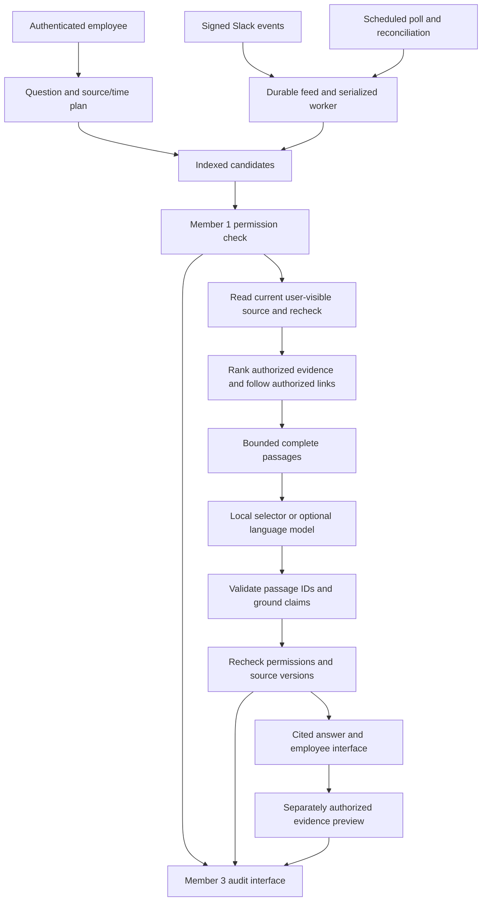

# Internal Brain — Member 2 delivery

Built **on Member 1's `internal-brain (2).zip`**, preserving his native permission, identity, synchronization and audit interfaces. Member 2 adds retrieval, evidence selection, answer checks, citation previews, an employee interface and an optional live Slack adapter.

The default app runs locally with fictional Company A data across Confluence, Jira, Slack and Google Drive. It needs **no cloud account or API key**. It returns complete source passages with citations. An optional language model selects which passages to use; the server supplies the actual factual text.

## Start here

Use Python 3.11 or newer (verified with Python 3.14). In this folder:

```sh
python3 -m venv .venv
source .venv/bin/activate
python -m pip install -r requirements.txt
python -m uvicorn app.main:app --host 127.0.0.1 --port 8000
```

Open **http://127.0.0.1:8000**. Choose Jane Doe and enter `demo`. The original teammate interface is retained at **/console**. Stop the server with Ctrl+C. On Windows, activate with `.venv\Scripts\activate` instead.

Try these questions:

- What's the status of the database migration project and were there any blockers raised in Slack last week?
- What are the steps in the payment-gateway failover runbook?
- Why did we choose JWT for authentication?
- Switch to contractor Kim and ask for the Q3 breach incident report. The response reveals no source metadata.

| Account | Role | Demonstrates |
|---|---|---|
| `jdoe` | Jane, backend engineer | Cross-platform retrieval with team access |
| `ravi` | Payments on-call | Payments documents and private on-call context |
| `asha` | Security engineer | Restricted security materials |
| `kim` | External contractor | Narrow shared access; neutral missing answers |
| `priya` | Compliance | Audit inquiry via the existing console |
| `dana` | Platform administrator | Operations and audit metadata; no automatic document access |

All demo passwords are `demo`. This is a local demonstration identity directory, not production SSO.

## What Member 2 delivers

- Search across all four platforms, exact issue identifiers, controlled vocabulary expansion, explicit platform filters and rolling Slack time windows.
- Live permission checks **before source content reaches the model**, current source reads, and another permission/version check before delivery. No positive permission cache across questions.
- Cross-source links followed only from permitted parents; each linked target is independently authorized. Hidden records cannot change corpus-wide ranking statistics or occupy a pre-authorization result cutoff.
- Bounded context composed of complete passages, stable passage IDs, exact text offsets and source versions. Old Slack messages retain their own timestamps when a thread receives a new reply.
- Strict grounding: unsupported claims, fabricated references, altered numbers, lost negations and unrelated extra citations are rejected. This proves that returned text occurs in supplied evidence; it does not prove the source itself is true or that every requested fact was answered.
- Clickable citations with independently authorized, version-checked previews. Account changes clear prior answers and evidence; API responses are not cached by the browser.
- Optional model selection with an explicit extractive fallback. Missing credentials and provider failures do not masquerade as successful AI generation.
- Optional live Slack with delegated user reads, signed durable events, deduplication, complete thread pagination and scheduled reconciliation.
- An employee UI for desktop and mobile; teammate operations and compliance screens remain available separately.

## Architecture



If evidence changes during generation, the draft is discarded and rebuilt once without the affected source. A second change withholds the answer. Changes after the final check remain the usual distributed-system race; a later preview or question checks access again. Neutral missing answers do not constitute a constant-time side-channel guarantee.

## Brief review and worked examples

The full scope was reviewed against this build. Read [the requirement-by-requirement review](docs/BRIEF_REVIEW.md) and [all five generated worked examples](docs/WORKED_EXAMPLES.md). Reproduce them with:

```sh
python scripts/judging_demo.py --markdown docs/WORKED_EXAMPLES.md --json evaluation/reports/judging-scenarios.json
```

Requested procedures retain every step in order; procedures too large for the evidence budget are withheld. Linked evidence can traverse up to three hops, with an authorization check at each hop.

## Verification

```sh
python -m pytest -q
python scripts/evaluate.py --json evaluation/reports/offline-evaluation.json --markdown evaluation/reports/offline-evaluation.md
python scripts/benchmark.py --size full --json evaluation/reports/synthetic-benchmark.json --markdown evaluation/reports/synthetic-benchmark.md
```

The delivery passed **225 automated tests**, **65/65 curated question cases**, all **56 citation obligations**, and all **16 expected abstentions**, with zero unauthorized context sources or citations in that set. Seven employee browser-check groups passed. See [evaluation methods](docs/EVALUATION.md), [saved reports](evaluation/reports/) and [browser checks](tests/browser/README.md).

The synthetic benchmark contains **19,700 objects** across 52 Confluence spaces, 32 Jira projects, 220 Slack channels and 150 Drive folders. It retrieved all eight target documents. This measures the local index, **not** live authorization throughput or complete answer latency. It is a generated workload, not a live enterprise crawl.

## Optional real connections

The default `IB_LLM_PROVIDER=stub` uses the offline evidence selector. To connect your approved Hunyuan or other compatible chat endpoint, set:

```sh
export IB_LLM_PROVIDER=openai_compatible
export IB_LLM_BASE_URL='YOUR_PROVIDER_BASE_URL'
export IB_LLM_MODEL='YOUR_AVAILABLE_MODEL_ID'
export IB_LLM_API_KEY='YOUR_KEY'
```

The adapter appends `/chat/completions` and expects the chat-completions response format. Use the endpoint/model from your provider account. HTTPS is required except on localhost. Real provider credentials were not supplied, so cloud integration has been tested with mock HTTP responses, not a live Hunyuan account. The model selects passage IDs; free-form paraphrasing is intentionally not enabled.

For live Slack, follow [the Slack setup and limits](docs/SLACK_MEMBER2.md) and [example configuration](examples/slack-config.example.json). `IB_SLACK_CONFIG` enables the adapter automatically. The signed endpoint is `/api/slack/events`; accepted events wake the background worker. It polls every five minutes by default and reconciles every fifteen minutes. `/api/slack/maintenance` is admin-only. Demo mutation controls are automatically disabled in this mode. Confluence, Jira and Drive remain simulated until teammates replace their adapters.

Environment variables are read at startup. `.env.example` is documentation; the application does not automatically load a `.env` file. Runtime data defaults to `data/`; set `IB_DATA_DIR` to change it. `requirements-lock.txt` captures the tested dependency versions.

## Integrating the team

Read [Member 2 handoff](docs/HANDOFF_MEMBER2.md) before merging parallel work. The original [Member 1 handoff](docs/HANDOFF_member1_to_member3.md) is retained. A generated change manifest accompanies the delivery.

Remaining team work includes trusted SSO/account mappings, real Confluence/Jira/Drive adapters, deployment secrets/rate limits, and independently protected audit checkpoints. The inherited audit checkpoint file is local and writable by the app: **external WORM storage has not been implemented**. Member 3 must supply that protection before claiming resistance to a fully compromised application.

The index is in memory and rebuilt at startup. Search currently uses deterministic lexical ranking, not embeddings or a vector database. Live permission checks cover every lexical candidate and may cause many API calls; batch/source-native authorization and measured capacity work are necessary for the full company footprint. Webhooks, reconciliation and read-through improve freshness, but outages, missing events, API rate limits and scan duration prevent an unconditional one-hour guarantee. A source newly relevant to a question cannot be found until its index entry has refreshed.

Demo screenshots are in [docs/screenshots](docs/screenshots/).
