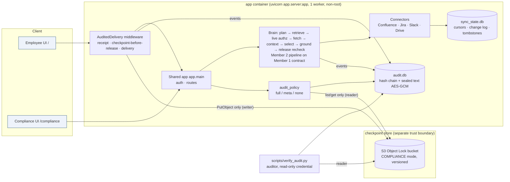

# Evidence pack: The Internal Brain

Submission assembly, owned by Member 3. Each member presents their own technical content; the sections marked **Member 1** and **Member 2** are theirs to complete.

## Architecture and trust boundaries

- The app holds a **put-only** checkpoint credential. It cannot delete, shorten retention or change the lock. Storage root can't delete a locked version either: that's tested live.
- Audit free text is sealed at rest. The chain commits to digests, so retention redaction never breaks verification.
- An answer is released only after a checkpoint covering its audit rows is committed.

## Live demo walkthrough (about 6 minutes)

1. Start the stack with `python3 deploy/make_env.py`, then `docker compose -f deploy/docker-compose.yml up -d --build`. Open `http://127.0.0.1:8000`.
2. **Member 2:** Jane asks the migration question and opens the citations. Kim asks for the Q3 breach report and gets a neutral answer.
3. **Member 1:** revocation before the next question, and a revocation during generation (`/console`, demo controls).
4. **Member 3:** open `/compliance` as priya.
   - Run the verifier: **Verified**, independent WORM store, with a labeled tail.
   - Search `actor=jdoe`, open the story, and show the versions sent to the model, the permitted-but-not-sent documents, the decisions, the release and the delivery.
5. **Member 3:** switch to dana. The metadata view shows only pseudonymised actors, and reconstruction is refused.
6. **Member 3:** tamper and outage:
   - Copy the DB out and edit one row, then run `scripts/verify_audit.py`: **failed: row modified**.
   - `docker compose stop minio`: the verifier reports **unverifiable**, and a new question gets a 503 "not released". `docker compose start minio` recovers.
7. **Backup:** `python scripts/demo_member3.py --markdown docs/demo-transcript-member3.md` replays every Member 3 scene on isolated data. The generated transcript is [demo-transcript-member3.md](demo-transcript-member3.md). A screen recording of steps 1–6 still needs to be captured by the team.

## Member 3: requirement → evidence (verification loop results)

Verified on 29 Sep 2026 with Python 3.13 (venv) and 3.14 (fresh copy), Docker 29.8 and Chainguard MinIO.

**Result: 276/276 tests pass with the live S3 endpoint. Without it, 272 pass and the 4 live tests skip.** Member 2's `scripts/evaluate.py` stays at 65/65. The full `diff -r` against the delivered zip shows changes only to the five Member-3-owned files.

| Brief requirement | Status | Evidence |
|---|---|---|
| Record receipt, per-document decisions, versions sent to the model, response or terminal failure, delivery outcome | Done | `test_answer_is_released_only_after_a_covering_checkpoint`, `test_pipeline_failure_records_a_terminal_failure_with_the_query_id`, `test_unauthenticated_ask_is_recorded` |
| Distinguish a permitted candidate from content actually used | Done | `permitted_not_sent` in reconstruction; `test_permitted_candidates_are_distinguished_from_context_sent` |
| Append order safe under concurrent requests and multiple workers (transactional) | Done | `BEGIN IMMEDIATE` per append; 8-thread and 4-process tests |
| Preserve request IDs through partial failures and restarts | Done | `request_id` column plus `X-Request-ID`; `test_restart_recovery_*`, `test_server_startup_closes_requests_interrupted_by_a_restart` |
| Checkpoints behind a separate trust boundary; writer can't overwrite or delete | Done | S3 Object Lock COMPLIANCE; live tests: writer DELETE → 403, versioned DELETE → 403, root DELETE → "WORM protected" |
| Verifier has a trusted record of the last committed checkpoint | Done | Reads the WORM listing with a read-only credential; `verified_through` |
| Explicit checkpoint semantics; newer tail never reported as verified | Done | Release rule; `uncheckpointed_rows` and `fully_verified`; `test_unanchored_tail_is_never_reported_as_verified` |
| Tests: modified rows, middle deletion, whole-chain rewrite, anchored and unanchored tail deletion, missing or unreachable store, concurrency, restart | Done | `tests/test_member3_audit.py`, live `test_live_tampering_is_detected_end_to_end` |
| Report verified, failed and unverifiable separately | Done | `verify_report().status`; CLI exit codes 0/1/2, all three demonstrated live |
| Drive: identity, direct/folder/group/domain sharing, personal/shared drives, limited-access folders, deletion and change tracking; metadata ≠ content | Done (simulated) | Contract suite plus 5 handoff extras; `tests/test_member3_drive.py` |
| Compliance filters: actor, time, document, platform, decision; reconstruction; verifier results | Done | `/compliance`, `/api/compliance/requests`; `test_compliance_filters_reconstruct_the_right_requests`; checked visually in the browser |
| Audit access to the audit system is itself audited | Done | `audit_accessed` / `audit_access_denied`, including verifier runs and pseudonym lookups |
| Protect raw questions and answers with an explicit audit policy shared with Member 1 | Done | Sign-off in `audit_policy.py`; AES-GCM sealing; 90-day retention; `test_admin_and_employee_cannot_read_protected_audit_content` |
| Durable index state or reliable rebuild; durable change cursors | Done | Rebuild from connectors at start; hardened `SqliteSyncStateStore` with retention (`test_sync_store_concurrent_writes_and_retention`) |
| Dependency locking, configuration checks, health reporting | Done | `deploy/requirements.lock` (hashes); `config_problems()` refuses unsafe startup; `/api/health` and `/api/health/detail` |
| Deployment instructions; clean reset of isolated demo data | Done | `docs/MEMBER3.md`, `deploy/`; `scripts/reset_demo.py`, `down -v` |
| Report observed freshness and failures, not the poll setting | Done | `health.sync.observed` (p50/p95/max by path); poll interval labeled "configured" |
| Evidence pack, architecture diagram, runnable demo | Done | This file; `scripts/demo_member3.py` |
| Backup recording | Partial | A generated transcript exists. The video must be recorded by a person |

**"Done when" checks:**

| Criterion | Result |
|---|---|
| An authorized auditor reconstructs a real question and its evidence versions | Pass: HTTP test, scripted demo scene 3, `/compliance` |
| Tampering is detected under the stated threat model | Pass: offline matrix plus live WORM end to end |
| Unavailable evidence produces an honest verifier status | Pass: `unverifiable` when the store is unreachable or empty; tail labeled; redactions counted |
| A fresh checkout reproduces the demonstration | Pass: clean copy, `pip --require-hashes`, tests, demo; `docker compose up` from the clean copy reached `verified` with `independent_worm` |

The threat model and its limits are in [MEMBER3.md](MEMBER3.md#threat-model).

## Member 1: permissions and synchronization (to be completed by Member 1)

- Identity mapping, Confluence/Jira adapters, connector contract, synthetic estate generator, authorization tests.
- Current evidence: [HANDOFF_member1_to_member3.md](HANDOFF_member1_to_member3.md), `tests/contract/`, `tests/test_member1_handoff.py`.

## Member 2: retrieval and answer quality (to be completed by Member 2)

- Search and planning, model adapter, grounding, Slack adapter, employee UI, evaluation.
- Current evidence: [BRIEF_REVIEW.md](BRIEF_REVIEW.md), [EVALUATION.md](EVALUATION.md), [WORKED_EXAMPLES.md](WORKED_EXAMPLES.md), `evaluation/reports/`.
